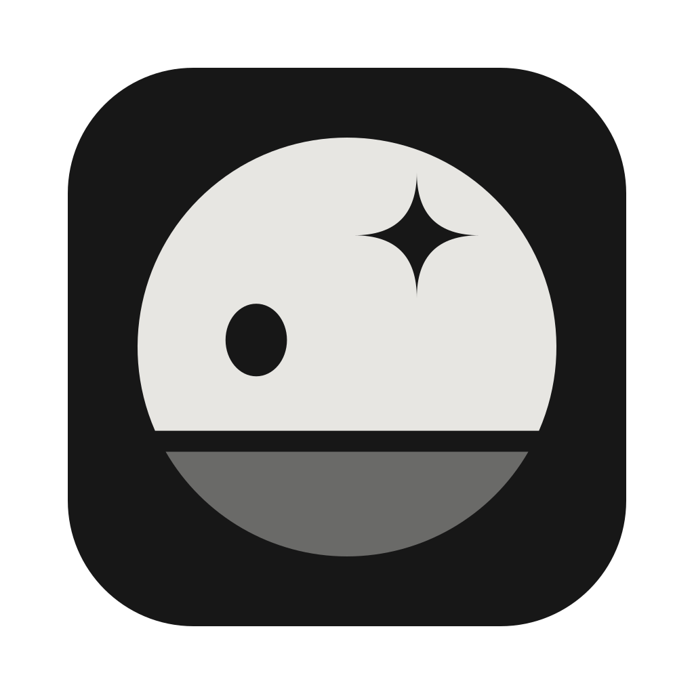

<div align="center">



# Bobble

### Your agents. One workspace.

Run coding agents in parallel. Review their work in one native app.

[Downloads](https://github.com/fr-anz/bobble/releases) · [Getting started](#getting-started) · [Development](#development) · [Credits](#credits)


</div>

## From a task to a branch you can review

Give Bobble a task, approve the plan, and let agents work in separate Git
worktrees. Follow progress in one place, inspect the diffs, and commit when
you're ready.

| | What you get |
| --- | --- |
| **Parallel agents** | A coordinator splits assignments across isolated worktrees, with up to four workers running at once. |
| **Review in context** | Read changes beside the conversation that produced them. Stage, commit, and manage branches without switching apps. |
| **A complete workspace** | A built-in terminal, syntax-aware editor, project search, and checkpoints for keeping or undoing a turn's changes. |
| **Persistent Minions** | Agents with memory, project context, and scheduled check-ins while the app is running. |
| **Recurring work** | Schedule code reviews, security scans, documentation, and other repeatable tasks. |
| **Visual answers** | Explore charts, Mermaid diagrams, and interactive visuals inside the conversation. |

<details>
<summary><strong>See the board and code review</strong></summary>

### Plan the work


### Review the result


</details>

## Make it yours with Luau

Add your own tabs to the right panel, and automate approvals, by saving small
[Luau](https://luau.org) files. Panels draw with the app's native components
and can embed its Explorer, Changes and History views. Hooks can allow or deny
an agent's permission requests by your own rules. Both run sandboxed and reload
when you save. See [Luau panels and hooks](docs/native/panels.md).

## Bring your own agents

Bobble drives the agent CLIs you already have installed, using the accounts
you're signed in to. It does not ship a model or include a model subscription.

**Claude Code · Codex · Cursor · OpenCode · Grok Build · Devin · Antigravity · Pi · Hermes Agent · omp · fx**

Configure CLI paths and accounts in **Settings → Providers**.

## Getting started

Install and sign in to at least one supported agent CLI, then choose a build from
the [releases page](https://github.com/fr-anz/bobble/releases).

| Platform | Package | Install |
| --- | --- | --- |
| Linux | x86_64 AppImage | Make the file executable, then open it. |
| Windows | x86_64 executable | Open the downloaded `.exe`. |
| macOS | Universal disk image | Open the `.dmg` and drag Bobble into Applications. |

Current builds are unsigned. Your operating system may ask you to allow the app
on first launch.

### Build and install on Linux

You'll need Git, a current stable Rust toolchain, and the native development
libraries listed in the [release workflow](.github/workflows/release.yml).

```sh
git clone https://github.com/fr-anz/bobble.git
cd placeholder
bash scripts/install-linux.sh
```

The installer builds the app and adds a launcher for the current user. Run
`bobble` from your terminal, or open it from your application menu.

## Development

The desktop app is built with **Rust and GPUI**. Its Cargo workspace lives in
`crates/bobble-gpui`; no JavaScript frontend build is needed for the native app.

```sh
# Build the native app
cargo build --locked --release --manifest-path crates/bobble-gpui/Cargo.toml -p bobble-gpui

# Run the native app
cargo run --locked --release --manifest-path crates/bobble-gpui/Cargo.toml -p bobble-gpui
```

The separate [Next.js website](site/README.md) lives in `site/` and exports to
static files for Cloudflare Pages.

| Path | Purpose |
| --- | --- |
| [`crates/bobble-gpui`](crates/bobble-gpui) | Native desktop interface, editor, terminal, and agent sessions. |
| [`crates/bobble-core`](crates/bobble-core) | Shared application logic. |
| [`site`](site) | Landing page, download page, and website assets. |
| [`scripts`](scripts) | Installation and release packaging. |
| [`docs/native`](docs/native) | Inherited architecture, feature notes, and verification records. |

Some inherited native documentation refers to npm commands and data paths
from the project this app was forked from. Use the Cargo commands above for this checkout.

## Credits

Bobble is a fork of MonoCode Native 0.16.0. Credit to its creators for the
foundation this project builds on, and to Zed Industries for GPUI.

Licensed under [MIT](LICENSE). Upstream copyright and third-party attributions
are preserved in [NOTICE](NOTICE). Agent names and logos belong to their
respective owners; Bobble is not affiliated with those providers.
